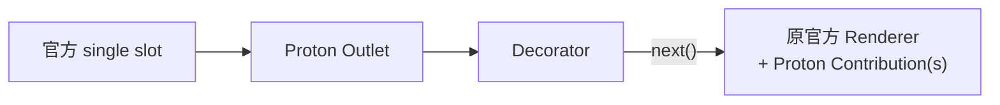

> **状态**：accepted（决策）· 已实施（单测与构建通过，运行中 DSH 的人工验收未做）
> **日期**：2026-11-04
> **读者**：维护组合层的人与 agent
> **范围**：只改本仓库 `packages/*`，不修改 DSH 上游
> **权威**：结构与支持边界的唯一出处；README 与各包 README 都指回这里

# 原 Slot Winner 共存

## 问题

官方 single slot 只有一个 winner。Proton 想在同一个位置插入自己的 UI（本机/远端选择、mesh 列表），有两条省事的路：复刻官方组件——上游改样式或行为就漂移；或要求上游提供 `renderDefault()`——但改不了上游。

本设计走第三条路：**占用 slot，然后把占用前的原 winner 请回自己的树里正常渲染**。不复制组件，不搬运 DOM，也不接管原注册的生命周期。

## 目标结构



## 核心方案

1. Proton 通过 `ctx.slots.entries(name)` 读注册记录，**排除自己的 Outlet**，得到原 winner。
2. 原 winner 的 `component` 与 `inject` 原样复用：按 entry identity 缓存并执行原 inject factory，把 injected props 与**当前** owner props 一起交给原 Component（owner 冲突字段优先）。
3. 原 entry 不卸载、不迁移，仍由官方 registry 与 Cordis 管理生命周期。Proton 只渲染它，不 dispose 它。
4. `RegionHost` 把原 entry 作为默认内容；Renderer 可替换默认内容，Contribution 追加内容，Decorator 决定是否以及何时调用 `next()`。
5. Outlet 订阅官方 slot 版本：原 winner 替换时跟随更新；Proton 最后一份内容卸载后 Outlet 撤离，官方 occupant 自然恢复。

## Region 协议

- **Renderer**：提供 Region 的默认内容，priority 小者获胜；与 Outlet 的 fallback（原 entry）互斥，有 Renderer 时 fallback 不渲染。
- **Decorator**：`next()` 返回其内层内容；多个 Decorator 按 order 组合，order 小者在外层。
- **Contribution**：以独立 id 追加在 Renderer/fallback 之后，按 order 排列。
- **occupied**：任一 Renderer / Decorator / Contribution 存在即为 true；native Outlet 只在 occupied 时注册，最后一份内容卸载后撤离。
- 所有注册返回幂等 disposer，调用方应放进自己的 `ctx.effect()`。

## 支持边界（唯一出处）

`OriginalSlotEntry` 只接受官方 native/browse directory-flow 的实际 entry 形态：

- root scope、plain inject；
- 无 `children`、`store`、`locale`、`hooks`、`keyedHooks` 声明。

其他形态**必须明确报错**（错误信息带 registrant），不能降级冒充。公开 API 拿不到完整的私有渲染上下文，所以「Proton 能自动包装任意官方组件」是不成立的承诺。

Outlet 采用接管时的 live winner 与接管后新注册的 entry；随后被官方 abdicate 的 entry 通过 `onEntryError` 排除。接管前已 shadowed 的历史 fallback 因公开 API 无法查询历史 abdication 而**不采用**：初始 winner 消失且无新 entry 时，Proton 选择空 fallback，而不是冒险复活已退役组件。

## 已知锐边

改这块代码前先看。每条都是会**静默出错**的失败模式，不是理论风险：

| 锐边 | 出错时的表现 | 对策 |
| --- | --- | --- |
| Outlet 自己也在 `entries()` 里 | 递归渲染自己 | 按 component 身份排除自身 |
| `inject` 每次 render 可能返回新值 | 每次渲染都重启原 native flow | 按 entry identity 缓存 inject |
| 原 entry 被卸载或替换 | 继续渲染已退役组件 | 跟随 slot version 更新，并用 `onEntryError` 排除 abdicated entry |
| 初次打开就调 `next()` | 官方 native picker 抢走本机/远端选择 | 用户明确选择本机前不调 `next()` |
| 远端 Promise 在取消或卸载后完成 | 对已关闭的流程调用 `onPicked` | active 标记 + ticket 守卫，晚到回调本地抑制 |
| 注入缓存与 React state 只在 Proton 持有 Outlet 期间成立 | 接管与恢复边界会 remount 官方组件，其瞬时状态可能重置 | 作为已知限制接受：不承诺状态连续 |

## 工作区域

`dsh-proton-workspace` 自己的注册有三处：`workspace.directoryFlow` 的 Decorator、`workspace.list` 的 section 接缝，以及 `hero.workspace` 座位（区域为空也占座，只换 kit 不换组件）。目录流的行为：

- 初次打开显示「本机 / 已注册来源」选择。
- 选本机 → 调用 `next()`，原生 OS picker 或官方 browse dialog 由原 entry 自己运行。
- 选来源 → 不调 `next()`，Decorator 渲染该来源给出的候选；选中后调 `source.adopt(id)` 换到本地路径，再交回官方 `onPicked(path)`。
- 关闭、取消、错误与最终 `onPicked` 仍使用官方 owner conversation。

来源由 backend 自己的适配包通过 `ctx.protonWorkspace.addSource()` 注册。本仓库不知道任何具体 backend，也不知道它会调哪些 HTTP —— 那是适配包与 backend 契约之间的事。

## 座位与契约归属

官方槽位 key 与 owner props 契约以 `dsh-proton-adapter-dsh` 的导出为准；域层服务（`WorkspaceServices`）由 `dsh-proton-workspace` 导出。同仓库的域包为了让两个 client bundle 各自独立，可以本地拼写 slot key，但要用测试钉住（`packages/workspace/tests/contract.test.ts`）。跨仓库的域包不享有这条例外，消费时用 `import type`，不要本地重声明：

```ts
import type {} from 'dsh-proton-adapter-dsh/composer'   // 事件与 protonComposer
import type {} from 'dsh-proton-workspace/services'      // protonWorkspace 服务
```

两个 client 入口会连带引入官方 ui-workspace 的 slot 声明；只消费契约时走 `composer` / `services` 这两个只含类型的子路径，就不会把别人的槽位表拉进自己的类型程序（自己的 vendor 分叉尤其会被撞）。

`import type` 在构建时被擦除，不产生运行时依赖，独立发版不受影响；它换来的是契约漂移变成编译错误。在本地抄一份同名类型会切断这道检查，问题只会在运行时出现。

composer 座位不随适配包常驻：消费者调用 `ctx.protonComposer.addSubmitTap()` 申请，最后一份释放后撤走；没人申请时 composer 完全由官方渲染。

## 包边界判据

包是部署单元，不是文件分组。三条判据同时成立才独立成包：

1. **省略后仍成立**：把它从 composition 里拿掉，剩下的仍是可用系统——官方 UI 原样、其他能力照常。
2. **省略的差别可感知**：装不装它改变的是渲染路径、依赖体积或变更节奏，而不是一次运行时开关。
3. **性质单一**：拆出去的内容属于同一种东西（域，或官方私有契约），准入标准能用一句话说清。

按这条判据，现状的分与不分：

| 东西 | 结论 | 理由 |
| --- | --- | --- |
| `dsh-proton` | 独立包 | 机制层，不带任何域也能成立 |
| `dsh-proton-adapter-dsh` | 独立包 | 官方私有契约的唯一出处；不装域时官方 UI 原样 |
| `dsh-proton-workspace` | 独立包 | 域：有状态（来源表、section、隐藏会话）与服务；省略后 adapter 仍成立 |
| composer 座位 | 并进 adapter | 官方契约适配、无状态；省略 = 不调用 `addSubmitTap()`，拆出去只能做薄壳 |
| directory-flow 席位 | 并进 adapter | 与 sidebar 列表同一上游族、同一类契约；没有「只要目录流不要列表」的部署 |
| `hero.workspace` 座位 | 留在 workspace | 它的行来自域，属于工作区域本身 |
| `/composer`、`/services` | 不是包 | 只含类型的子路径，没有部署意义 |

复查触发，任一成立就重新判：

- 省略后的组合不再成立（例如 adapter 开始强制渲染官方座位）。
- 省略的差别变成用户可感知：第二个不装 workspace 的 composer 消费者，或这段代码大到影响安装。
- 拆出去不再是薄壳：composer 长出状态或策略（草稿预处理、附件路由、发送队列）。

## 非目标

- 不修改或 monkey patch 上游，不读 React internals，不搬 DOM。
- 不自动支持所有官方 slot entry 形态（见「支持边界」）。
- 不替域包决定座位内容：官方槽位接线与 owner 契约只在 `dsh-proton-adapter-dsh`，域包通过 region 与 `ctx.protonWorkspace` 参与。
- 不修改 `dsh-workspace-mesh` 的 Host API，不实现 VS Code 布局。
- 本地锚点不是远端挂载：agent loop 始终在归属机。
- 不为 mesh 请求增加网络 abort（mesh API 改动超出范围）：晚到的 owner 回调在本地抑制。

## 验收

自动判据，在仓库根执行，全部退出码 0：

```sh
pnpm test
pnpm typecheck
pnpm build
node --check packages/core/lib/client.js
node --check packages/adapter-dsh/lib/client.js
node --check packages/workspace/lib/client.js
```

覆盖的行为：

- 渲染的是原 Component，并收到缓存的 inject 与最新 owner props；重复渲染不重复执行 inject。
- children / store / locale / hooks / keyedHooks 形态抛出带「不支持」语义的错误。
- Outlet 排除自身，跟随 winner 更新，卸载后两个官方席位都恢复。
- Decorator 未选本机时原 Component 不运行；选本机后经 `next()` 运行。
- 远端分支的单操作、取消/卸载失效、焦点与错误行为。

未覆盖（不得据此声称验收通过）：

- 真实窗口中的点击、焦点、HMR 与卸载。
- mesh 列表与锚点 Promise 的晚到拒绝路径；现有 active/ticket 守卫未变。

## 谁提供被影子条目的 props（已实施）

占用座位之后，原 winner 由 Proton 画。宿主渲染器在渲染期会合成一批第三方拿不到的
props：按 scope 注入的 standard props、`locale` 命名空间对应的 `t`、`store` 对应的
`useStore`/`actions`、`children` 对应的 `renderSlot`，以及 `hooks`/`keyedHooks` 对应的
`use<Name>` 选择器钩子。`EntryFace`（core）负责装配这份 kit，但**它不知道这些
props 从哪来**。

分工因此固定为：

| 层 | 职责 |
| --- | --- |
| `dsh-proton`（core） | `EntryFace` 装配 kit；`ctx.proton.addEntrySources` 收 provider；缺源时 fail loud |
| `dsh-proton-workspace` | 认领工作区域的那条 entry，交出 `useWorkspaces`、`locale.bind('workspace')`、store 绑定 |
| 其它域包 | 只贡献自己的 section，不参与"怎么画别人的组件" |

这条分工的判据是可验证的：**卸掉域包之后，工作区列表仍然正常渲染**。2026-11-05 在
dev 上实测过一次——把远程工作区包整个从 composition 里摘掉，列表照常两行、无报错。

## 装配层必须守住的不变量

1. **props 身份稳定**：kit 按 entry 记忆；`subscribe`/`getSnapshot` 按源只建一次；
   keyed hook 按 `(key, member)` 缓存。任一破坏都会变成 React 的 update-depth 错误。
2. **outlet 绘制不得抛出**：宿主会把抛错的条目判为崩溃并退位，原组件于是悄悄回来。
3. **owner props 必须下传**：`renderSlot(key, owner)` 的 owner 是调用方的业务 props，
   丢掉它等于让子条目拿不到 `open`/`onPick`。
